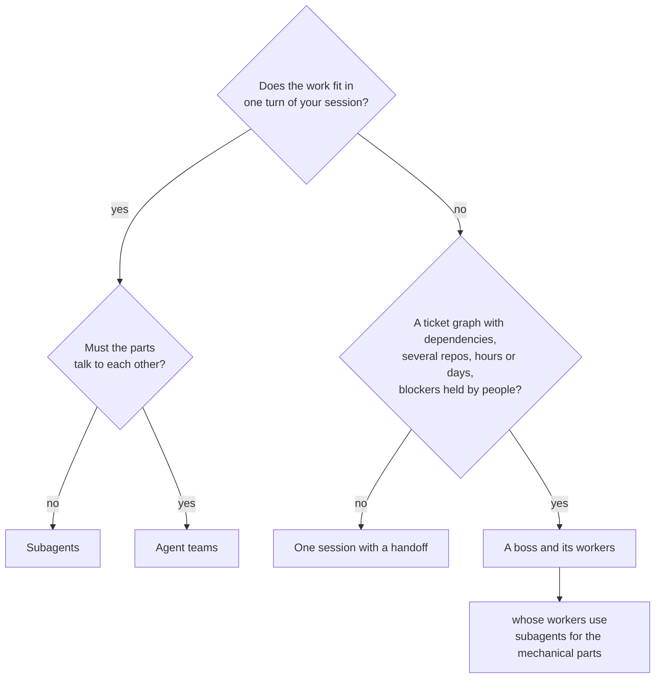

# claude-boss

One Claude Code session coordinates the others. It dispatches work to worker
sessions, keeps its tracker on disk, escalates a blocker on a timer, and asks
you one question when it needs you.

The hard part is not dispatching. It is a coordinator that quietly stops
coordinating — starts writing the code itself, forgets a worker went idle, or
ends its turn while blocked and says nothing. Six hooks exist for that, and each
one came from a measured failure rather than a guess.

## When a boss is the right tool, and when subagents are enough

Claude Code already runs work in parallel without this plugin: background
subagents (the `Agent` tool) and, experimentally, agent teams. For most work
they are the right choice, and a boss's own workers use them. The difference
is not intelligence but lifetime: a subagent lives inside one turn of your
session, a boss lives above several independent sessions, for days, with its
state on disk.

| | Subagent | Agent teams | Boss |
|---|---|---|---|
| Lives | one turn of your session | as long as the lead session | days; each worker is restarted fresh per task |
| State | in your context | in the lead's and teammates' contexts | on disk: tracker, objective, handoffs |
| Survives the coordinator compacting | no | no | yes, a hook hands the tracker back |
| You can watch it and type into it | no, you get a summary | the agent panel | yes, every worker is a tmux pane |
| Escalates a blocker while nobody is awake | no | no | yes, from a systemd timer |
| Needs | nothing | an environment variable | tmux, two timers, this plugin |
| Maintained by | Anthropic | Anthropic | you, from this repo |

A subagent is an intern you send to look something up: you do not see the
work, you get the answer, and then they are gone. That is the right tool for
anything that fits in one conversation (three review lenses on a diff, five
research questions, the mechanical half of a task) and it is cheaper.

A boss is a project manager with a team at desks you can walk past. It writes
no code itself (a hook counts when it does), keeps a board that still exists
when it is away, and rings you only when something needs your hand. A worker
whose context fills up writes a handoff and is replaced by a fresh one with the
same name and the same pane.



So the question is never boss or subagents. Reach for a boss only when the
work does not fit in one session. For one straight line of work, one session
with a handoff is enough, and a boss over a single worker is overhead.

## What the hooks do

| Hook | Event | What it catches |
|---|---|---|
| `boss-guard.py` | PreToolUse | The boss implementing instead of delegating. Says so once, then keeps a running count — measured across 21 sessions, the old version repeated one sentence 2,589 times, about 215,000 tokens. |
| `boss-pulse.py` | Stop | A boss going quiet with idle workers, an overdue escalation rung, or an open blocker it never put to anyone. |
| `boss-compact.py` | PreCompact, SessionStart | Hands the tracker back after an autocompact, so a 450k compaction costs the boss nothing. |
| `boss-reap.py` | SessionEnd | Per-session state outliving its session. |

They all early-exit unless the session registered itself as a boss, so an
ordinary session pays a process spawn and nothing else.

## Install

```bash
/plugin marketplace add sweatshop-ai/cc-agent-names
/plugin install claude-boss@sweatshop-ai
```

Then, from the checkout, for the parts a plugin cannot do — state directories
and the two systemd timers:

```bash
./install.sh          # BIN=1 also puts boss-start on your PATH
```

The timers run the plugin through one stable path,
`$CLAUDE_CONFIG_DIR/routines/claude-boss`, a symlink to wherever the plugin
lives. A marketplace upgrade lands in a new cache directory, and the
SessionStart hook `bin/boss-link` moves the link there on the next session, so
the units never point at a version that is gone. `install.sh` runs once; it
does not need re-running after an upgrade.

Start a boss inside tmux:

```bash
skills/boss/bin/boss-start [track]     # then type /boss
```

## What it needs

**tmux.** A boss spawns workers into panes and reads their state from them. It
cannot start without one.

Everything else is optional and degrades quietly:

| | For | Move it with |
|---|---|---|
| a Slack credentials file | escalation alerts to a channel | `BOSS_SLACK_ENV` (default `~/.config/tiroir/slack.env`) |
| a session dashboard that watches `status: waiting` | the chime that rings when the boss is waiting on you | — |
| [cc-agent-names](https://github.com/sweatshop-ai/cc-agent-names) | human names in the roster instead of machine strings | — |

cc-agent-names is **not** a dependency. Claude Code writes the session registry
and names sessions itself; the plugin swaps a machine name for a human one. A
roster of eight just reads better. With it installed, a name the boss gives a
worker (`spawn <dir> <name>`, `claim <pane> <name>`) goes through its
`agent-name set` and survives the next prompt and a resume; without it the
name is written straight into the session's peer file.

One more file is yours and deliberately not in this repo, because putting it
here would publish what it exists to protect:

| File | What it holds |
|---|---|
| `$CLAUDE_CONFIG_DIR/boss-hard-rules.tsv` | `name<TAB>regex` lines naming your own off-limits hosts, paths and services. `boss-run` checks them exactly like its built-in rules. Absent, only the generic rules apply. |

Point `BOSS_HARD_RULES` elsewhere if you prefer.

## Handing a plan to a boss

`/claude-boss:hand-to-boss <plan> [boss-model] [worker-model]` takes a plan
and the tickets `to-tickets` cut from it, writes a brief for a boss, commits
it beside the tickets, and starts that boss in its own tmux session
(`boss-<track>`). It answers with the boss's name, so you can talk to it.

```
grill -> plan -> to-tickets -> hand-to-boss -> boss + workers
```

A handoff passes a conversation to one agent. This passes a dependency graph
to a manager with a team, so the brief carries what one agent never needs: the
frontier, who holds each external blocker, the models, one worktree per worker,
how a ticket is claimed, the rules that must hold for days, and the hours when
something must not be touched. `--dry-run <dir>` writes the brief and stops.

It needs two skills this plugin does not ship: one to settle the plan
(`grill`, or Matt Pocock's `grilling`) and `to-tickets` from the same suite,
whose local-file ticket format it reads. Without tickets in that format it
stops and says so.

It never fires on its own. To see the frontier of any ticket folder:

```bash
python3 skills/hand-to-boss/frontier.py path/to/issues
```

## The board

Phase C reads a GitHub project board, and which board is yours, not this
plugin's. Set `BOSS_BOARD_OWNER`, and optionally `BOSS_BOARD_REPO` and
`BOSS_BOARD_NUMBER`. With none set the boss skips Phase C and says so.

## Where things live

Code is this repo. State is your Claude config dir, and neither install nor
uninstall touches it:

```
$CLAUDE_CONFIG_DIR/pm/              trackers, objectives, markers
$CLAUDE_CONFIG_DIR/routines/        timer state and logs
```

Every path is an environment variable with a sensible default, so the plugin
installs on a machine that looks nothing like the one it grew up on.

## Upgrading from the pre-plugin layout

If you ran the boss out of `~/.claude/skills/boss/` with the six hooks typed
into `settings.json`, those hooks now fire twice — once from the file, once from
the plugin. Strip the hand-written ones:

```bash
python3 scripts/unwire-legacy-hooks.py --dry-run ~/.claude/settings.json
MIGRATE=1 ./install.sh
```

It removes only entries naming a boss script, leaves every other hook alone, and
writes a timestamped backup first.

## Tests

```bash
for t in skills/boss/test_*.py skills/hand-to-boss/test_*.py; do python3 "$t"; done
```

They run each hook the way the harness does — as a process, JSON on stdin,
against a throwaway `CLAUDE_CONFIG_DIR`. Nothing touches your real state, posts to a channel or moves a tmux pane. The tests of `boss-run` and the
reviewer chain run them on a sealed `PATH` (`skills/boss/hermetic.py`) where
`codex`, `claude`, `gh` and `tmux` are stubs that log their calls, so no real
reviewer is asked. `boss-run --selftest` is not part of this: it calls real
reviewers.

## License

MIT.
