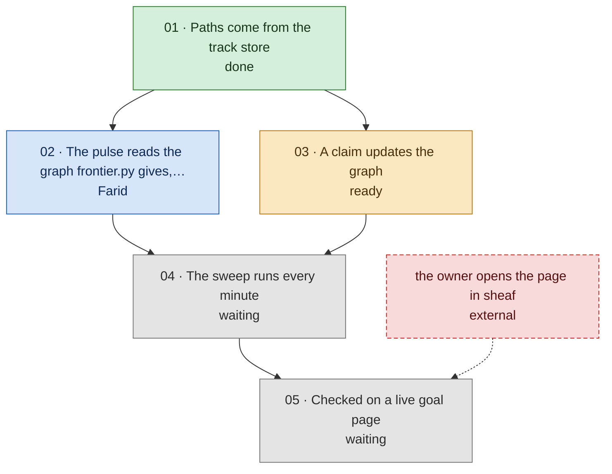

<!-- ticket-graph:start (written by claude-boss from the Tickets source; edits here are overwritten) -->

5 tickets: 1 done, 1 in progress, 1 ready, 2 waiting · read 11:00
<!-- ticket-graph:end -->
